<div align="center">


# NexFlow

**An open-source automation app that makes your phone smarter** — build your own automations as **WHEN → THEN** flows.
Like MacroDroid or Tasker, but fully open source, with a UI rebuilt in Material 3.

[](https://www.android.com)
-blue)
[](https://kotlinlang.org)
[](https://developer.android.com/jetpack/compose)
[](#license)
[](https://play.google.com/store/apps/details?id=com.adsf.nexflow)

[繁體中文](README.md) ｜ **English**

</div>

---

## 📸 Screenshots

| My flows | Flow editor (WHEN → THEN) | Action picker |
|:---:|:---:|:---:|
| 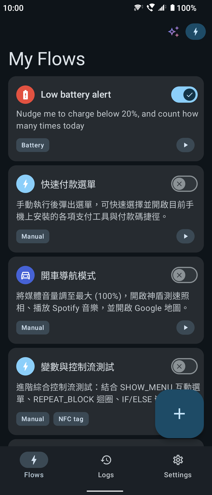 | 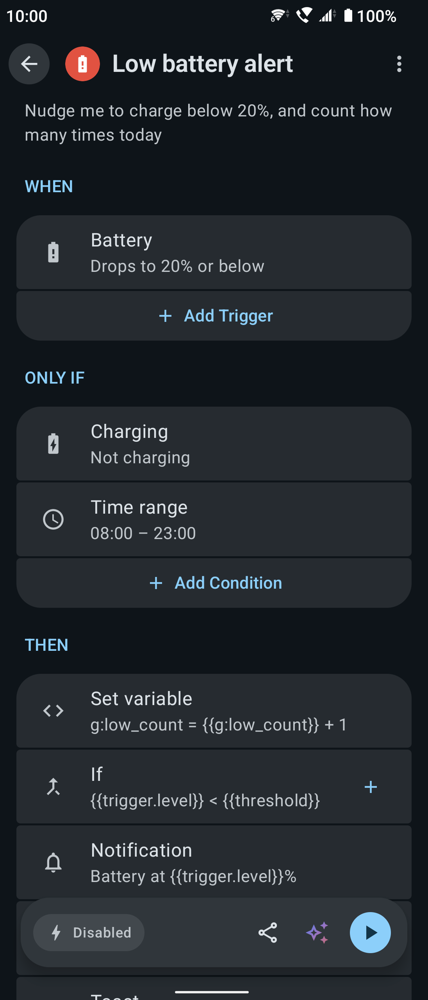 | 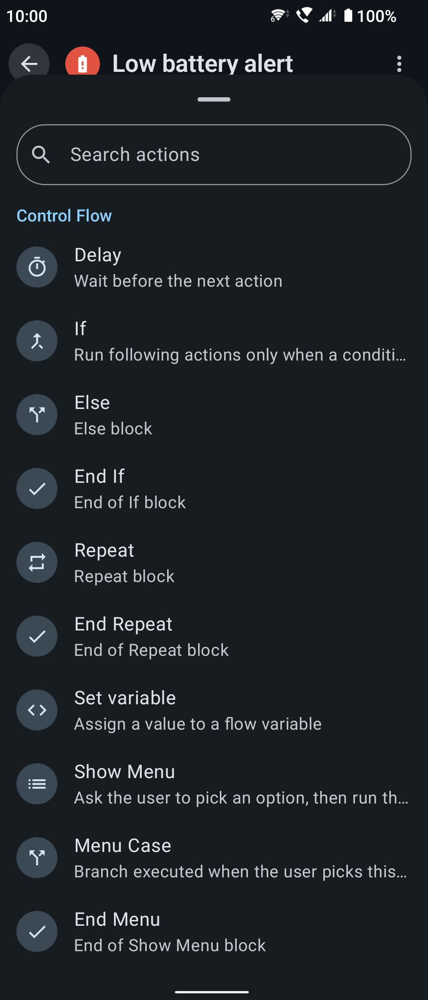 |
| Every flow at a glance; switch on or run with one tap | Combine triggers, conditions and actions | 16 triggers × 34 actions, grouped and searchable |

| Execution logs | Permission guidance |
|:---:|:---:|
| 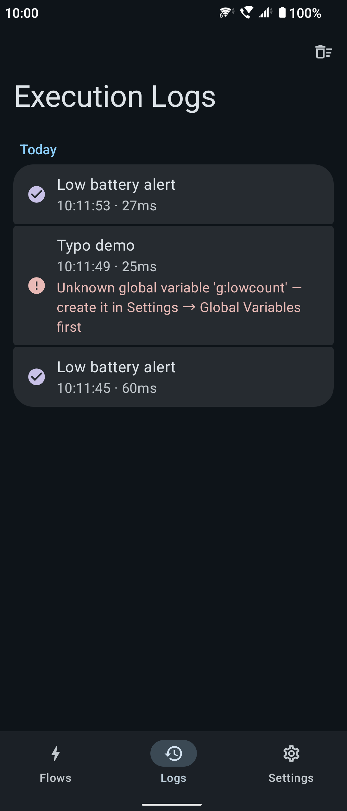 | 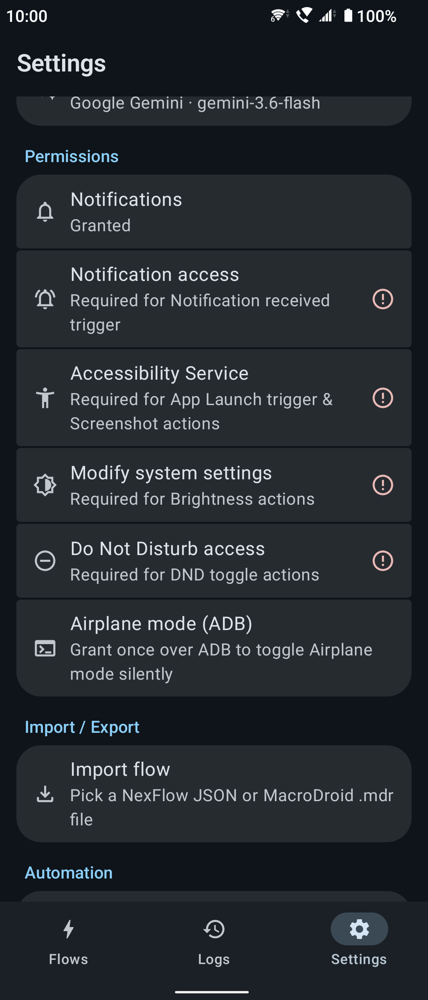 |
| Success or failure of every run, with a clear reason | Each permission a feature needs, one by one |

## ✨ What can it do?

- 🔋 **Below 20% battery, turn on power saving and switch Bluetooth off**
- 🏠 **When you get home and join the Wi-Fi, restore the volume and turn on Do Not Disturb**
- 🌙 **At 11 pm, take a screenshot of an expense notification and send it to your server**
- 📷 **Tap an NFC tag to open a specific app and read out today's schedule**

If you can phrase it as "**in this situation → do that**", you can almost certainly build it. NexFlow also has **conditions, variables, If/Else branches, Repeat loops and menus**, and imports MacroDroid `.mdr` / `.macro` files. The app is available in **English, 繁體中文, 简体中文 and 日本語**.

> ✨ **Rather not build it by hand?** The built-in **Gemini AI assistant** turns a description, typed or spoken (say, "when I plug in headphones, set the volume to 80% and open Spotify"), into a flow you can review and save. It needs your own Gemini API key from Google AI Studio; see [AI assistant](#-ai-assistant-gemini).

---

## 📥 Download

NexFlow is published through two channels:

| Version | Where | Difference |
|---------|-------|------------|
| **GitHub** (`github`) | Download the APK from [**Releases**](https://github.com/ADSFAaron/NexFlow/releases) and install it yourself | **Full feature set** |
| Google Play (`play`) | [**Google Play**](https://play.google.com/store/apps/details?id=com.adsf.nexflow) | Under Play policy, leaves out SMS / incoming-call / phone-call features, simulated taps and swipes, and airplane mode switching; otherwise identical |

> ℹ️ Both versions share a package name, but the Play version is signed by Google Play, so **one usually cannot be installed over the other**. To switch, uninstall first (export your flows beforehand). Pick the GitHub version only if you need one of the features Play leaves out; the Play version updates itself.

**Installing the GitHub version:**

1. Download the latest `app-github-release.apk` from the [**Releases**](https://github.com/ADSFAaron/NexFlow/releases) page
2. **Verify the file first** (see "Verifying the download" below) and install only if the hash matches
3. Open the APK with a file manager; when Android asks, allow installs from that source
4. After the first launch, follow the Settings tab to grant the permissions each feature needs

### 🔐 Verifying the download (strongly recommended)

A sideloaded APK is not scanned by a store, so **check it against the published SHA-256 hash** to make sure the file has not been tampered with or swapped. Every release lists its hash.

```bash
# macOS / Linux
shasum -a 256 app-github-release.apk

# Windows (PowerShell)
Get-FileHash app-github-release.apk -Algorithm SHA256
```

Install only if the output **matches exactly** what the release page shows.

Optionally, check the APK's **signing certificate fingerprint** too, to confirm it was signed with this project's key and not repackaged by someone else:

```bash
apksigner verify --print-certs app-github-release.apk | grep -i "SHA-256"
```

The fingerprint should match the one published in the release notes.

---

## Features

### Triggers (16)

| Category | Triggers |
|----------|----------|
| Time | A set time (every day / weekdays / weekends / custom days / once — "once" remembers its exact date and never runs again after it) |
| Device | Battery level (including charging state), screen on/off/unlock, boot, headset plugged/unplugged, **shake**, **ambient light** |
| Connectivity | Wi-Fi connected/disconnected (optionally a specific SSID), Bluetooth device connected/disconnected |
| Communication | Incoming call (optionally from a contact), SMS received (optionally from a sender, with a keyword), notification received (optionally from an app, matching the title/text by contains / exact / regex) |
| Other | App launched, NFC tag scanned, geofence (enter/exit), manual |

### Conditions (8)

The trigger decides *when*; conditions decide *whether this time*. Add as many as you like under "Only if" on the flow page — the flow runs only if all of them hold, and when one doesn't, the log records a "skipped" run naming the condition that stopped it.

| Condition | Example |
|-----------|---------|
| Time range, day of week | Only on weekdays, 9:00–18:00 |
| Battery level, charging | Only sync above 50% battery |
| Wi-Fi connected, Bluetooth connected | Optionally a specific SSID / device name |
| Screen state | Screen on / off |
| Expression | Your own test on variables, e.g. `{{g:mode}} == work` |

### Actions (34)

| Category | Actions |
|----------|---------|
| Notifications | Toast, system notification, text-to-speech |
| Device | Wi-Fi, Bluetooth, Do Not Disturb, airplane mode, volume, brightness, media playback, screenshot, wallpaper, **simulated tap / long press**, **simulated swipe**, **speakerphone** |
| Communication | Phone call, send SMS |
| Web & data | HTTP request (store the response in a variable, optionally picking a field by JSON path), open URL, clipboard, write file, share |
| Apps | Open app, **launch an app shortcut** (another app's manifest shortcuts / shortcut-creating activities) |
| Flow control | Delay, If / Else / End If, Repeat / End Repeat, set variable, Show Menu / Menu Case / End Menu |

> 🔋 The **shake** trigger listens to the accelerometer for as long as its flow is enabled, which costs a little battery (ambient light is event-driven and costs almost nothing).
> 🖐️ **Simulated taps and swipes** need the accessibility service and exist only in the `github` version (the `play` version leaves them out under platform policy). **Speakerphone** is best-effort; audio routing during a call is ultimately up to the device maker.
> 📶 **Wi-Fi switching**: since Android 10, third-party apps cannot turn Wi-Fi on or off themselves, so the action brings up the system Wi-Fi panel for you to confirm with one tap.
> 📋 **Menus (Show Menu)** started by a background trigger may not be allowed to open on screen; when Android blocks it, NexFlow posts a "A flow is waiting for your choice" notification instead — tap it to choose. A menu nobody answers within 5 minutes ends on its own.

#### 🖐️ Simulated taps and swipes: no coordinate hunting

A simulated touch needs **screen pixel coordinates**, which is no fun to work out by hand. So both actions let you **pick the point from a screenshot**:

1. Take a system screenshot (power + volume down) of the screen you want to touch
2. Pick that screenshot in NexFlow
3. **Tap the spot on the image** and the coordinates are filled in; for a swipe, tap twice (start, end) and the path is drawn as you go

The point is converted to device coordinates **as a proportion of the image**, so it stays right even if the screenshot was saved at a different resolution. A cropped image (wrong aspect ratio) triggers a warning instead of producing coordinates that look plausible but are wrong.

> ℹ️ Android offers no API for a third-party app to record touches in **other apps** (`ACTION_OUTSIDE` coordinates have been zeroed since Android 12), so "record a gesture and turn it into coordinates" isn't possible; picking from a screenshot is the best approach that needs neither root nor ADB.
> A longer "hold time" on a tap makes it a **long press**; a swipe's "duration" is the speed the target app sees (short = a quick flick, long = a slow drag, e.g. along a seek bar).

### Widgets, Quick Settings and shortcuts

- **Home screen widgets**: an overview (4×3, recent or hand-picked flows), a single flow (1×1) and a wide single flow (2×1) — tap to run
- **Quick Settings tile**: run a chosen flow from the notification shade
- **Home screen shortcuts**: "Add to home screen" on a flow's page **pins it as a shortcut** (if your launcher supports it). It runs the flow without opening the app, and a flow with a menu shows it right over the home screen

### Execution logs

- Every run is logged as succeeded / failed / skipped, with the reason, grouped by day
- **Run details** list each action's outcome step by step: which way an If went, which Repeat round, what was picked in a menu
- "Settings → Detailed execution log" also records each action's settings after variables were filled in, for debugging; how long logs are kept is adjustable

### 🤖 AI assistant (Gemini)

Describe what you want in plain language, typed or spoken, and Gemini drafts the complete flow through function calling:

- **Your own key**: get a free Gemini API key from Google AI Studio and enter it under "Settings → AI assistant". The key stays on the device, is excluded from cloud backups and is never written to logs
- **Conversational**: the assistant asks follow-up questions, looks up installed apps to resolve package names, and then builds the flow, showing its progress as it works
- **Voice input**: dictate through the system speech recognizer, with a Gemini-style gradient while it listens
- **Keep refining**: ask for tweaks in the same conversation and it updates the same flow; or start a new conversation
- **Edit an existing flow**: open the assistant from a flow's page and ask it to change that flow; its proposal is shown as the editor's cards with the differences marked
- **Attach images**: the "+" next to the input attaches a screenshot or photo, so the assistant can build from what's on screen
- 🔒 Flows from the assistant are always added **disabled** and must be reviewed and granted their permissions before they run (the same gate as imports); the assistant sticks to automation and declines unrelated topics

> 💡 **Communication features (SMS / calls) are `github`-only.** The Google Play version (`play` flavor) leaves out those features and permissions under platform policy; see [Building](#building).

### Variables and expressions

A flow can declare variables (with default values) and reference them in any field as `{{name}}`; the Set variable action changes them while the flow runs.

There are also **global variables, shared across flows**: create them under "Settings → Global variables" and reference them anywhere as `{{g:name}}`. Writing one with a Set variable action named `g:name` **persists** the value, so other flows read it (cross-flow counters, state flags). Variable menus mark globals (🌐 `global`) apart from local variables **by color and icon**.

<div align="center">

| Global variables | Set variable (local or global) |
|:---:|:---:|
| 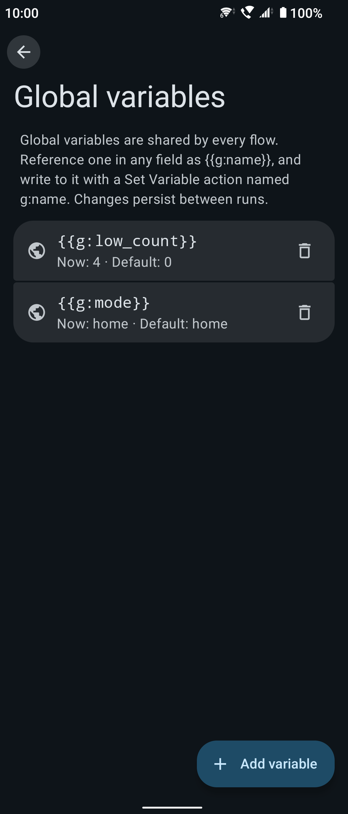 | 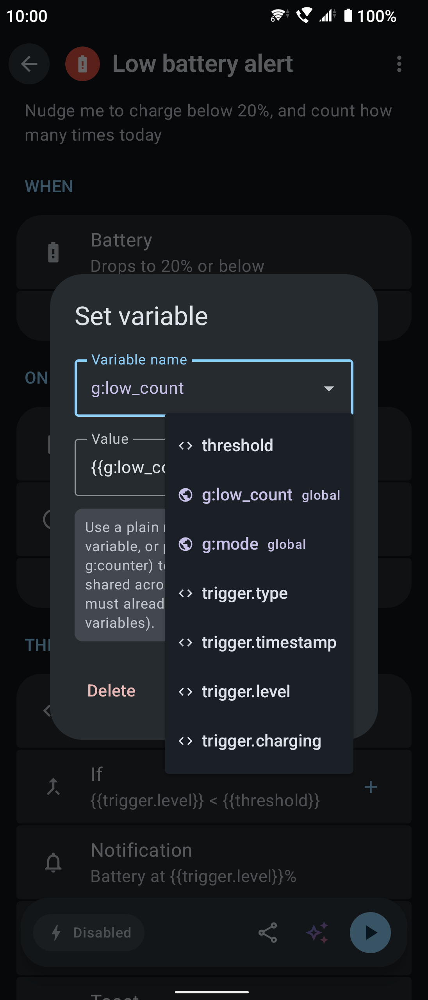 |
| Created under "Settings → Global variables", shared by every flow | Pick an existing variable; globals marked with 🌐 |

</div>

**No typing variable names** — a typo in a name silently breaks a flow, so variables and conditions are picked rather than typed:

| Feature | What it does |
|---------|--------------|
| 🔘 **Insert-variable menu** | Every text field has a `{ }` button listing the flow's variables; the one you pick is inserted at the cursor |
| 🧩 **Condition builder** | An If is three fields, **value A → operator → value B**, not free text: values come from the variable menu, the operator from a dropdown (`==` / `!=` / `<` / `<=` / `>` / `>=`), and the expression is assembled on save |
| ⚠️ **Unknown-variable warning** | When a dialog contains a `{{name}}` this flow doesn't have (a typo, a rename, a leftover from an old import), a red warning appears and **Save is disabled**, so a misspelled name can't be stored |
| 🌐 **Undeclared globals** | A Set variable naming a `g:name` that doesn't exist is flagged and blocked the same way (such names have no `{{ }}`, so the check above can't see them). If one slips in anyway (an old imported file), the run fails and the log names the variable |

<div align="center">

| Condition builder | Insert-variable menu | Unknown-variable warning |
|:---:|:---:|:---:|
| 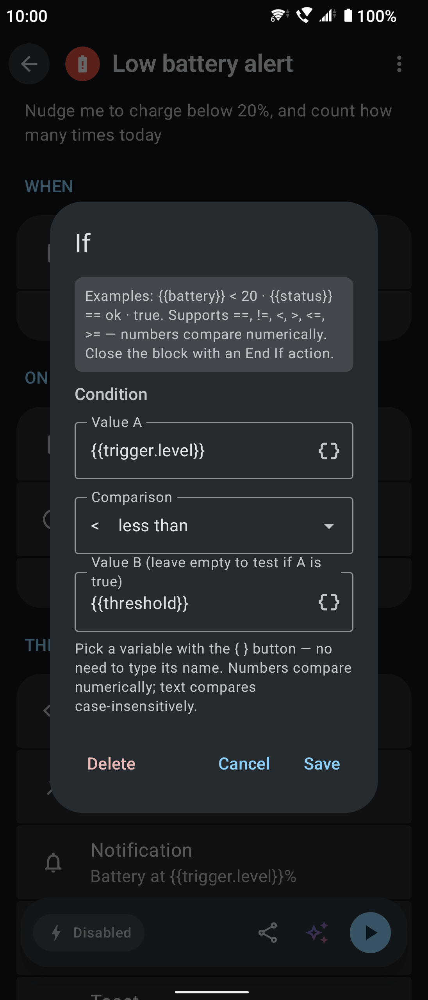 | 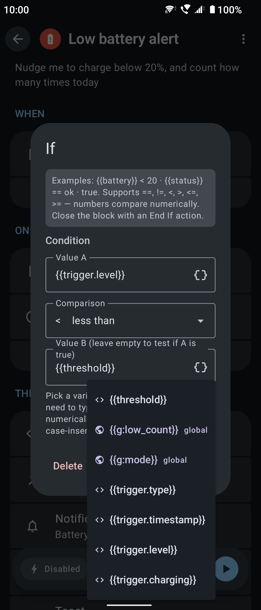 | 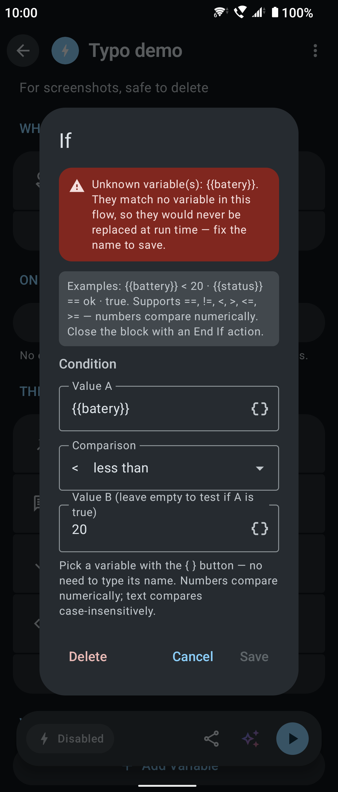 |
| Three picks, no expression to type | The `{ }` button lists the flow's variables | A mistyped `{{name}}` is flagged right away |

</div>

The condition builder turns those picks into an expression the interpreter understands, with nothing typed by hand:

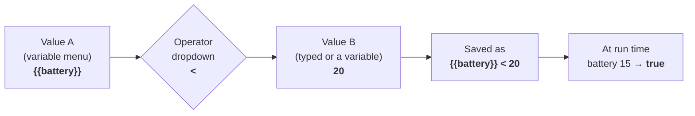

> When both sides are numbers they are compared numerically, otherwise as case-insensitive text. **Leave value B empty** to test whether value A is true. The stored expression format is unchanged, so older flows open and round-trip correctly.

### Import / export

- Native format: `.flow` (JSON); see [docs/FLOW_SCHEMA.md](docs/FLOW_SCHEMA.md)
- MacroDroid: `.mdr` (full backup) and `.macro` (single shared macro) exports are parsed and converted, settings included (`core/macrodroid-compat`; format notes and mapping sources in [docs/MACRODROID_IMPORT.md](docs/MACRODROID_IMPORT.md))
- Import from the file picker or the system share sheet; export and share from a flow's page
- 🌐 An exported `.flow` carries **declarations of the global variables** it uses (name / type / default value), and missing ones are created on import — `{{g:name}}` keeps working on another device. Only declarations travel, not current values (a counter's mid-count value means nothing on another phone), and an existing global of the same name is never overwritten
- 🔒 Imported flows are always added **disabled**, and files shared from other apps ask for confirmation first, so a malicious file can't run on arrival. A flow whose id is already on the device is **saved as a new copy** instead of replacing yours
- 🛡️ A flow shared by someone else can only do so much: "Launch app shortcut" only accepts a shortcut picked from the list (not one built from variables), "Write file" can't write into NexFlow's own folder, and each flow may send at most 5 SMS, place 5 calls and make 60 web requests a minute — extra steps are skipped and you're notified

---

## Tech stack

| Item | Version |
|------|---------|
| Kotlin | 2.4.10 (KSP 2.3.11, no kapt) |
| AGP / Gradle | 9.4.0 / 9.7.0 |
| UI | Jetpack Compose (BOM 2026.08.00) + Material 3 1.5.0-rc01 (including the Expressive API) |
| DI | Hilt 2.60.1 |
| Database | Room 2.8.4 |
| Networking | Ktor 3.5.2, kotlinx.serialization 1.11.0 |
| Other | Navigation Compose 2.9.8, WorkManager 2.11.2, Glance 1.1.1 (widgets), Coil 3.5.0, play-services-location 21.4.0 (geofences) |
| Testing | JUnit 5.14.4, Robolectric 4.16.1, MockK 1.14.11, Turbine 1.2.1, Compose Preview screenshot tests |
| SDK | minSdk 30 (Android 11) / targetSdk 37 |

## Modules

```
app/                        # Android app: UI, Room, Hilt, trigger/executor implementations, services
core/automation/            # Pure Kotlin JVM: domain model, FlowInterpreter (IF/REPEAT/variables), repository interfaces
core/flow-schema/           # Pure Kotlin JVM: .flow JSON serialization and validation
core/macrodroid-compat/     # Pure Kotlin JVM: MacroDroid .mdr parsing and conversion
```

### Architecture

- **Triggers**: a `TriggerHandler` interface plus Hilt multibinding (`@Binds @IntoSet`, registered in `app/.../di/ExecutionModule.kt`). Android components (AccessibilityService, NotificationListener, BroadcastReceiver…) reach the handlers through singleton event sources (`MutableSharedFlow`)
- **Actions**: an `ActionExecutor` interface with the same multibinding. Control-flow actions (IF/REPEAT/SET_VARIABLE) are handled by `FlowInterpreter` itself and need no executor
- **Engine**: `FlowEngine` watches the enabled flows and keeps one subscription per (flow, trigger); when a trigger fires it hands the flow to `FlowInterpreter` and writes the execution log
- **Adding a type**: add the enum to `TriggerType`/`ActionType` → implement the handler/executor → bind it in `ExecutionModule` → describe its fields in `TriggerConfig`/`ActionConfig`. Automated tests catch any missed step (see [Testing](#testing))

## Building

```bash
git clone https://github.com/ADSFAaron/NexFlow.git
cd NexFlow
```

The project has two **product flavors**:

| Flavor | Purpose | SMS / calls | Simulated taps / swipes | Output |
|--------|---------|:---:|:---:|--------|
| **`github`** | Sideload / GitHub Releases, **full feature set** | ✅ | ✅ | APK (installs directly) |
| `play` | Google Play (SMS / incoming-call / phone-call permissions and code removed under Play policy, along with simulated taps/swipes and airplane mode switching) | ❌ | ❌ | AAB (for upload) |

```bash
./gradlew :app:assembleGithubDebug     # full debug APK (development, debug signing)
./gradlew :app:assembleGithubRelease   # full release APK (for sideloading users) ★
./gradlew :app:bundleGithubRelease     # full release AAB
./gradlew :app:bundlePlayRelease       # Play release AAB (for upload)
```

Outputs:

| Task | File |
|------|------|
| `assembleGithubRelease` | `app/build/outputs/apk/github/release/app-github-release.apk` |
| `bundleGithubRelease` | `app/build/outputs/bundle/githubRelease/app-github-release.aab` |
| `bundlePlayRelease` | `app/build/outputs/bundle/playRelease/app-play-release.aab` |

> 💡 **APK vs AAB**: for a GitHub release that users install directly, ship the **APK** (`assembleGithubRelease`). An AAB can't be installed directly; it is the format Google Play splits for download (installing one locally needs `bundletool`).

Requirements: JDK 17+ (the Gradle toolchain handles the modules' JVM 11 target) and Android SDK Platform 37.

### Release signing

Release builds need an **upload keystore**, configured in `app/keystore.properties` (ignored by `.gitignore`, never committed):

```properties
storeFile=/absolute/path/to/upload-keystore.jks
storePassword=********
keyAlias=upload
keyPassword=********
```

Without that file the release tasks still configure, but produce an **unsigned** APK (which won't install). To create a key the first time:

```bash
keytool -genkey -v -keystore upload-keystore.jks \
  -alias upload -keyalg RSA -keysize 2048 -validity 10000
```

> ⚠️ **Keep the key offline, private and backed up**: every future update of the same app (`com.adsf.nexflow`) must be signed with **the same key**, or users can't upgrade in place.

### Publishing and checksums (SHA-256)

So users can confirm the APK they downloaded is untouched, **every release should include its checksums** in the GitHub release notes:

```bash
APK=app/build/outputs/apk/github/release/app-github-release.apk

# 1) File hash (SHA-256) — paste into the release notes
shasum -a 256 "$APK"

# 2) Signing certificate fingerprint — proves the APK was signed with this project's key
apksigner verify --print-certs "$APK" | grep -i "SHA-256"
```

Attaching a `SHA256SUMS.txt` to each release is recommended:

```bash
shasum -a 256 "$APK" > SHA256SUMS.txt
```

## Testing

Tests come in four layers, all gated on pull requests by `.github/workflows/ci.yml`. Because of the flavors, every task name includes one (`testDebugUnitTest` or `connectedDebugAndroidTest` don't exist).

| Layer | Location | Command | For |
|-------|----------|---------|-----|
| JVM unit | `core/*/src/test`, `app/src/test` | `./gradlew :core:automation:test`, `:app:testGithubDebugUnitTest` | Logic with no Android dependency: interpreter, expressions, scheduling, engine subscriptions |
| Robolectric | `app/src/test` (`@RunWith(AndroidJUnit4::class)`) | same as above | Needs the Android runtime but not a device: Room (with foreign keys), sticky broadcasts, config dialog rendering |
| Screenshot | `app/src/screenshotTest` | `./gradlew :app:validateGithubDebugScreenshotTest` | Layout, text length in all four languages, light and dark |
| Instrumented | `app/src/androidTest` | `./gradlew :app:connectedGithubDebugAndroidTest` | What only real Android has: the full Hilt graph, Room migrations, the scheduled trigger end to end |

Without a device, use Gradle Managed Devices; Gradle downloads and boots the emulators:

```bash
./gradlew :app:api30GithubDebugAndroidTest     # the minSdk floor
./gradlew :app:api36GithubDebugAndroidTest     # background restrictions from Android 12 on
./gradlew :app:ciGroupGithubDebugAndroidTest   # both
```

> On a physical device, turn system animations off before instrumented tests, or Compose text-input tests time out waiting for idle:
>
> ```bash
> adb shell settings put global window_animation_scale 0
> adb shell settings put global transition_animation_scale 0
> adb shell settings put global animator_duration_scale 0
> ```

A few tests worth knowing:

- `ExecutionBindingsTest` (instrumented) — checks against the real Hilt graph that every TriggerType has a handler and every executable ActionType an executor, catching "forgot to register it in `ExecutionModule`", which would otherwise only blow up at run time
- `TriggerConfigTest` / `ActionConfigTest` / `ConfigDialogRenderTest` — the fields and summary of **every** trigger and action, and their dialogs actually rendering and saving
- `NexFlowDatabaseMigrationTest` (instrumented) — run it on every schema change; `DatabaseModule` has no destructive fallback, so a failed migration means the app crashes on launch for existing users
- `TimeTriggerEndToEndTest` (instrumented) — walks "alarm fires → service starts → flow runs → log written" on a real system

Lint is a CI gate too: `./gradlew :app:lintGithubDebug :app:lintPlayDebug`. There is no baseline and warnings count as errors; a deliberate exception gets `@SuppressLint` at that spot with a comment saying why. The full testing rules are in [CONTRIBUTING.md](CONTRIBUTING.md) (Traditional Chinese).

## Permissions

Some features need you to grant access by hand (the app's Settings tab walks you through each):

| Feature | Permission |
|---------|------------|
| App-launched trigger, screenshot action, simulated taps / swipes | Accessibility service |
| Notification trigger | Notification access (notification listener) |
| Notification action, alerts (a flow couldn't run, a limit was hit, a menu is waiting) | Notifications (Android 13+) |
| On-time scheduled triggers | Alarms & reminders (`SCHEDULE_EXACT_ALARM`) |
| Geofences | Precise location + background location |
| Wi-Fi trigger for a specific SSID | Location (Android requires it to read the SSID) |
| Brightness | Modify system settings (WRITE_SETTINGS) |
| Do Not Disturb | Do Not Disturb access |
| SMS / call triggers, sending SMS, calls (`github` only) | SMS and phone permissions |
| Silent airplane mode switching (`github` only) | `WRITE_SECURE_SETTINGS` (granted once over ADB; the app has the command ready to copy) |
| AI assistant voice input | Microphone |
| NFC trigger | Any tag while the app is open; with the app closed, NDEF tags only, and only while an NFC flow is enabled |

## Known limitations

- A global variable must exist under "Settings → Global variables" before it can be written: a Set variable never creates one from a mistyped `g:name` (so a typo can't quietly create a stray variable). Dialogs refuse to save an unknown `g:` name; if one gets in anyway (e.g. an old imported file), the run **fails and the log names it** rather than skipping silently
- **MacroDroid support is partial**: 22 trigger, 30 action and 7 constraint MacroDroid class types are mapped (MacroDroid has hundreds). Everything else becomes `UNSUPPORTED`, with a warning per item on import (the original class name is kept in the config so you can fill in an equivalent by hand). Settings are mapped for 46 classes; a field without a mapping, or one that doesn't convert, is also listed in the warnings rather than silently dropped. Conversion is best-effort, so review complex macros before enabling them — the things that are known not to convert (geofence coordinates, per-option menu actions, shortcuts, wallpaper images…) are listed in [docs/MACRODROID_IMPORT.md](docs/MACRODROID_IMPORT.md)
- **On-time triggers need "Alarms & reminders"**: TIME triggers use `AlarmManager`, and on Android 12+ without `SCHEDULE_EXACT_ALARM` they fall back to inexact alarms — still delivered through Doze, but possibly batched into a maintenance window, **up to an hour late** (an hour is all Android guarantees for inexact alarms). Without the permission **the flow card shows a warning** that takes you to grant it, and existing schedules are corrected as soon as you do
- **Battery saving can stop non-time triggers**: shake, ambient light, Wi-Fi / Bluetooth, headset, screen and similar triggers live in the foreground service's event streams and stop listening if the system or the device maker's battery saver kills it (TIME is driven by AlarmManager and unaffected). There is **no in-app guide yet for exempting NexFlow from battery optimization**; on aggressive devices, allow it in system settings yourself
- **A flow never runs twice at once**: a trigger that fires while its flow is still running is dropped (so repeated triggers don't stack up parallel runs), and **dropped triggers are not queued**
- **Wi-Fi can't be switched silently**: since Android 10, third-party apps can't turn Wi-Fi on or off (no permission changes that), so the action brings up the system Wi-Fi panel for you to confirm
- **Silent airplane mode switching needs a one-time ADB grant** (`github` only): `WRITE_SECURE_SETTINGS` must be granted by hand (the app has the command to copy); without it, the action opens system settings instead
- **Background menus need a tap on a notification**: without the accessibility service enabled, Android blocks a menu screen opened from the background, so NexFlow posts a notification for you to open it; a menu unanswered for 5 minutes ends, and the flow stops at that step
- **Background NFC covers NDEF tags only**: with the app open, NFC goes through `enableReaderMode` and reads any tag. With it closed, it goes through `TECH_DISCOVERED` with a tech-list of `Ndef` / `NdefFormatable` only — transit cards, access badges (MifareClassic) and contactless payment (IsoDep) don't report `Ndef`, so **they don't trigger in the background**. That is deliberate: a wider filter would make NexFlow the catch-all receiver for those cards. Also, **a tag holding a URL still opens the browser** (`NDEF_DISCOVERED` takes priority). The background filter sits on an `<activity-alias>` that is disabled by default and only switched on while you have an enabled NFC flow — otherwise NexFlow doesn't take part in tag dispatch at all

## Contributing

Bug reports, feature ideas and pull requests are welcome (new triggers / actions, translations and wider MacroDroid support especially):

- 💬 [**Discussions**](https://github.com/ADSFAaron/NexFlow/discussions) — questions, sharing flows, half-formed ideas
- 📋 [**CONTRIBUTING.md**](CONTRIBUTING.md) — development setup, flavors and test commands, and **the four required steps for a new Trigger / Action** (in Traditional Chinese)
- 🤝 [**CODE_OF_CONDUCT.md**](CODE_OF_CONDUCT.md) — community code of conduct (Contributor Covenant 2.1)
- 🔐 [**SECURITY.md**](SECURITY.md) — please **report vulnerabilities privately**, not in a public issue

## License

Licensed under the [Apache License 2.0](LICENSE). Copyright 2026 ADSFAaron and the NexFlow contributors.
By contributing, you agree to release your contribution under the same license.
